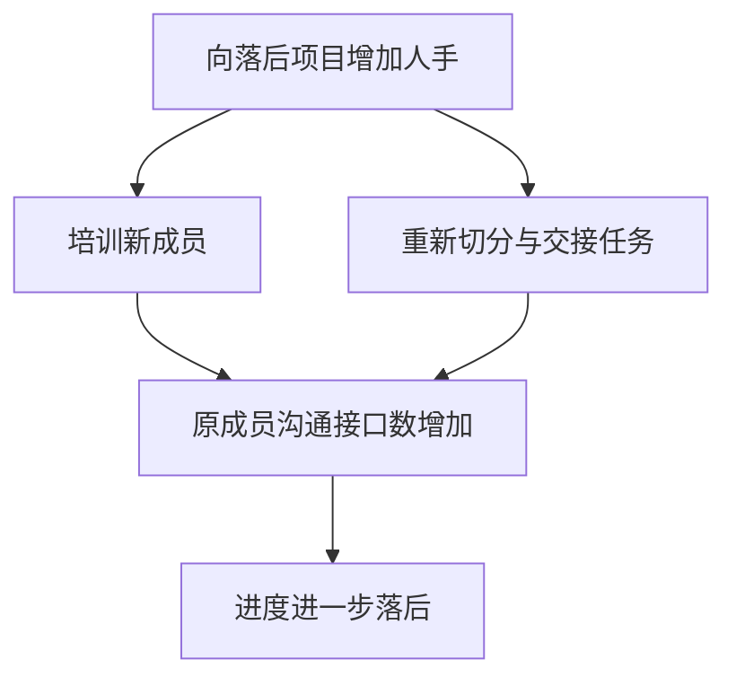
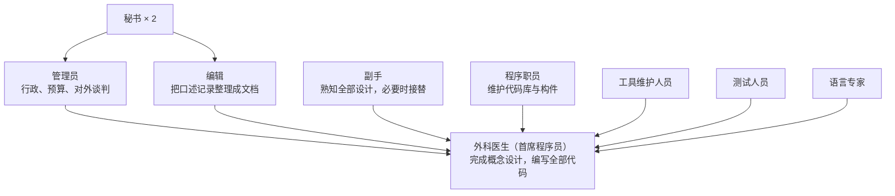
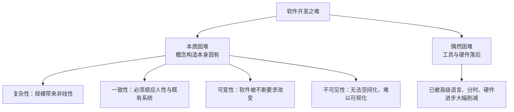

# 第 1 章 焦油坑

大型系统编程就像史前巨兽陷入焦油坑：越是庞大强干的个体，挣扎得越剧烈，陷得越深。本章先厘清"程序"与"产品"的差别，再谈这份职业的乐趣与苦恼。

## 程序、产品与 9 倍成本

一个能在开发机器上由作者自己运行的**程序（program）**，距离真正有用的东西还很远。它有两条演化路径：

- **编程产品（programming product）**：通用化、系统测试、完整文档，成本约为程序的 3 倍。
- **编程系统（programming system）**：能与其它构件按接口规范集成，成本约为程序的 3 倍。
- **编程系统产品（programming systems product）**：同时具备产品化与系统化属性，成本约为程序的 9 倍。

所谓"少数几个星期写成的程序"，演变为真正可用的产品，代价远高于直觉估计。

## 职业的乐趣

一是创造事物的纯粹快乐，像孩子用沙堆出城堡；二是制造对别人有用的东西；三是把齿轮、杠杆拼装成精密机构的过程；四是任务千变万化带来的持续学习的乐趣；五是工作在易于驾驭的介质上——编程是纯粹的思维活动，只需思考，介质顺从听话。

## 职业的苦恼

一是必须追求完美，错一个比特程序就不能工作；二是目标由他人设定，资源由他人供给，概念创造者无法掌控自己的命运；三是概念性设计完成之后，动手实现的乐趣要交给别人；四是寻找最后一个 bug 的枯燥；五是成果刚刚完成，技术就已换代，伴随成果而来的往往是过时。

# 第 2 章 人月神话

本章是全书的出发点：**人月**作为进度与成本的计量单位，是一个神话。它只在任务可完全分割、且不需要沟通时才成立。

## 人月不可互换

人月隐含"人员与时间可以互换"。割小麦式的任务可以无限加人，但十月怀胎无论多少女人都要十个月。程序设计属于中间类型：任务可分割，但分割后需要大量的相互沟通。

## 沟通成本平方增长

n 人团队需要维护 n(n−1)/2 个两人沟通接口。增加人手不仅带来新成员的培训成本，还要求把原有的工作重新切分给更多人——所有这些都会消耗现有成员的精力。

由此得到**布鲁克斯法则**：向进度落后的软件项目添加人手，只会使进度更加落后。

## 乐观的进度安排

编程工作本质上不可精确预估，而管理者又倾向按"一切顺利"估算。作者给出的经验分配是：1/3 计划，1/6 编码，1/4 构件测试与早期系统测试，1/4 系统测试（全部构件就位后）。测试占了将近一半时间，却总是被乐观地压缩。

另一方面，小型精干队伍效率极高，却又无法在合理时间内完成大型系统——效率与规模之间的矛盾，引出下一章的方案。

# 第 3 章 外科手术团队

解决"小型精英团队效率"与"大型项目需要人力"的矛盾，办法不是让每个人都去切分问题，而是让一个大脑完成设计，其余人做支持工作。

## 团队结构

Mills 建议仿照外科手术团队组织开发：不是一屋子屠夫各切一块，而是一名外科医生主刀，其他人各司其职。典型角色共 10 人：

## 为什么有效

外科医生与副手掌握全部设计，保证**概念完整性**；管理员、编辑、程序职员等承担所有支持性工作，使外科医生免于琐事。团队获得 10 人规模的支撑能力，而设计仍出自一个头脑。代价是：合格的外科医生（首席程序员）稀缺，这个角色也难以在普通人事体系中培养和晋升。

# 第 4 章 贵族专制、民主政治和系统设计

概念完整性是最重要的考虑因素。为了获得它，设计应该由一个人或少数相互默契的人完成——系统设计是贵族专制；但任何人都可以提出设计建议，实现工作则可以民主地开展。

## 完整性与易用性

功能丰富而概念混乱的系统难用；概念完整统一的系统即使功能较少也易用。易用性来自设计的概念完整性，而不是功能的堆积。结构师宁可省略不规则、非本质的功能，也不破坏完整性。

## 两种定义

概念必须既用**形式化定义**（精确、无二义）又用**散文定义**（可读、可讨论）表述，两者互相校验。写形式化定义会暴露文字描述的含糊之处，写散文定义会暴露形式化定义的武断之处。

结构师把定义交给实现者，实现者的问题与反馈反过来检验定义。任何设计歧义都必须有唯一权威的裁决者。

# 第 5 章 画蛇添足

第二个系统是最危险的系统。设计师的第一个系统往往精雕细琢、趋向简洁谨慎；设计第二个系统时，他知道"这一次可以放手去做"，于是倾向加入修饰性功能与华而不实的技巧。OS/360 正是许多设计师的"第二个系统"，因此格外臃肿。

## 对策

结构师必须有自律精神，明确区分必要功能与修饰功能；邀请资深的系统评估者从外部审查设计，发现并删除多余功能；当功能与概念完整性冲突时，完整性优先。第三个及以后的系统才会趋于成熟克制。

# 第 6 章 贯彻执行

结构设计再优秀，如果无法准确地传递给实现者，也毫无价值。本章讨论设计决策的沟通机制。

## 书面规格

所有设计决策必须写入**书面规格**。概念应当用形式化定义和散文定义两种方式表述，并在实现开始前校对一致。口头传说式的沟通无法支撑大型项目。

## 答案人与会议

结构师充当"答案人"：所有实现者的问题被记入**电话日志**，答案公布给全体成员，一个人的问题成为所有人的答案。另设定期的大型技术会议：结构师向实现者讲解设计，实现者当场提问与挑战。

## 项目工作手册

所有规格、接口定义、变更记录、会议记录集中放入**项目工作手册**，活页装订、及时更新，任何成员都能查阅。工作手册是项目共享的"数据库"，配合正式的变更控制流程，保证所有人基于同一份当前事实工作。

# 第 7 章 为什么巴别塔会失败

巴别塔有清晰的目标、充足的人力、齐备的材料和可行的技术，却失败了——败在语言混乱带来的沟通与组织失灵。大型编程项目的失败，原因也通常在组织而非技术。

## 沟通的基础设施

项目工作手册是全体成员沟通的基础设施：它定义了"什么是当前真实的设计"。配合变更控制，使每个成员都知道自己在建造什么、同伴在建造什么。

## 产品负责人与技术主管

两类职责必须清晰划分：

- **产品负责人（producer）**：决定"做什么、何时做"，掌管资源、进度与对外谈判。
- **技术主管**：决定"怎么做"，主持技术设计与裁决。

两个角色可以由一人兼任，也可以由两人分担，但同一人兼两职时必须明确此刻戴的是哪顶帽子。无论哪种组织，"管理决策"与"技术决策"都不能无人负责——巴别塔的教训就是没有人为沟通与权威负责。

# 第 8 章 胸有成竹

本章用数据说明工作量与生产率，给估算提供经验依据。

## 关键发现

- 编码只占编程时间的一半左右，测试、调试、文档占用的时间总是被低估——按编码时间估算排期往往少算一半。
- 程序员之间的生产率差异巨大，最好与最差可达约 10 倍。
- 生产率与使用的语言级别强相关，高级语言可带来约 5 倍的效率提升。
- 经验只在最初几年明显提高生产率，之后趋于平台期。

## 非线性增长

程序规模扩大一倍，工作量增长数倍而非一倍。线性外推是估算失效的根源。工作量估算必须考虑规模、语言级别与人员差异，并给测试留下充分余量。

# 第 9 章 削足适履

程序必须装进有限的内存。规模控制不是优化技巧，而是项目管理问题。

## 规模预算

像管理资金一样管理存储空间：在规格说明中为每个功能分配**规模预算**，写入进度表。规模是产品的一部分，要像度量成本一样度量并报告它。

## 超支怎么办

超出预算时，唯一的办法是削减功能或重新设计，而不能让规模悄悄膨胀。宁可交付一个功能精简、尺寸合规的系统，也不要一个臃肿的超支系统。项目经理必须有坚持预算的权威。

## 空间-时间折中

在微观层面，可以用紧凑的表示、重新计算代替存储、提取公共代码等技巧换取空间；但这些只能在内核中局部使用，系统级的规模仍靠预算与纪律控制。

# 第 10 章 提纲挈领

两三个人开发的小程序靠口头约定即可运转；大型项目则必须依赖少数关键文档。

## 关键文档

项目必须有：目标定义、技术规范、进度表、资金预算、组织结构图、工作手册、空间与职责分配。每份文档都要有明确的归属、定期复审与更新。

## 为什么需要正式文档

- 书面记录决策迫使人们把想法想清楚，含糊之处在落笔时暴露。
- 文档是沟通的数据库，避免同一问题被反复口头解释。
- 文档是检查列表，让评审有据可依；进度是否偏离计划，对照文档便知。

文档不是形式主义，而是大型项目中"当前事实"的唯一权威载体。

# 第 11 章 未雨绸缪

无论如何你都会抛弃一个系统，所以事先就计划好要开发一个原型。第一个系统很少是最好用的：只有交付用户使用之后，团队才能真正理解需求，而到那时，按最初理解建造的第一个系统已经积重难返。

## 为变更而设计

变化不可避免：硬件在变，用户需求在变，规格说明必然有错误。系统应当被设计为可变更的：模块化、清晰的接口、可扩展的数据结构、完备的文档，使每次修改只影响局部。

## 维护的代价

每次修复都有引入新缺陷的风险，修复越晚代价越高；文档不全时，维护者只能靠猜。把系统当作持续演进的实体，以增量方式构建与交付，而不是毕其功于一役——这也是第 16 章"没有银弹"中演进式开发主张的雏形。

# 第 12 章 干将莫邪

磨刀不误砍柴工。大型项目必须为工具投入专门的资源。

- **目标机器**：目标机的机时是最稀缺的资源，必须正式调度，像管理资金一样管理。
- **辅助机器**：仿真器、小型机承担部分工作，让昂贵的大机时间用在刀刃上。
- **受控程序库**：所有构件版本化管理，防止构件被随意覆盖，保证任何人拿到的都是正确版本。
- **高级语言**：提高生产率，代价是消耗更多资源；OS/360 选择了 PL/I。
- **交互式编程**：分时系统把反馈循环从小时级缩到秒级， debugging 效率成倍提升——批处理排队浪费的正是程序员最宝贵的心智流畅状态。

# 第 13 章 整体与部分

如何保证系统能工作？构件必须正确，集成也必须正确。

## 防范 bug

清晰的定义是防范 bug 的第一道防线：模块职责明确、接口无二义，bug 就没有藏身之处。结构师应坚持概念清晰，宁要简单而明确的方案，不要精巧而含糊的方案。

## 调试原则

- 在组装之前尽早测试每个构件，不要等系统集成后才发现构件级错误。
- 用真实的"脏"数据做系统测试，人造数据会漏掉真实世界的意外。
- 控制变更：一次只做一个变更并记录，出问题才知道是哪个变更引入的。
- 定位 bug 用二分法：逐步缩小可疑范围，而不是漫无目的地检查。
- 每个 bug 都要追根溯源，它往往暴露了设计或实现中的系统性缺陷，而不是孤立失误。

集成宜渐进：逐步拼装、随时可测，优于一次性总装后再调试。

# 第 14 章 祸起萧墙

大项目很少突然崩溃，灾难是逐渐积累的：进度每天滑落一点点，直到无可挽回。温水煮青蛙式的慢性偏差是最大的威胁。

## 里程碑必须可度量

里程碑必须是具体的、特定的、可度量的事件，例如"某模块通过全部测试用例"。"编码完成 90%"不是里程碑，而是自欺欺人的模糊状态——剩下的 10% 往往要花一半的时间。用 PERT 图标识**关键路径**，关键路径上的每一天延误都会原样传导到交付日期。

## 应对之道

坏消息必须尽早向上传递，掩盖延误只会累积成灾难。通过每周的项目状态会议逐模块走查，保持对进度的真实感知。一旦确认落后，手段是削减任务、重新排期，而不是用加班掩盖，更不能盲目加人——那是第 2 章布鲁克斯法则的反面教材。

# 第 15 章 另外一面

程序的另一面是面对用户的文档：说明书与手册。它们同样是产品的一部分，写作质量直接决定用户眼中的产品质量。

## 写作建议

- 像对话一样写：第二人称、主动语态、现在时，"你输入命令，系统显示结果"。
- 术语一致：同一概念全文只用同一个名字。
- 功能规格说明与使用手册分离：前者说明"做什么"，后者说明"怎么用"。

## 对流程图的质疑

作者认为详细流程图被严重高估：它复述代码的逻辑却不如代码精确，维护时必然与实际实现脱节。代码本身才是权威描述；图表应只在真正能增进理解的地方少量使用。让代码可读、注释解释意图而非复述代码，配合良好的手册，胜过成堆的文档与流程图。写文档的过程本身也会暴露设计的不一致——写不出来，往往意味着没想明白。

# 第 16 章 没有银弹

本章收录作者 1986 年的论文《没有银弹》。核心论断：十年之内，没有任何一项单独的技术或管理上的进步，能够保证软件的生产率、可靠性和简洁性获得数量级（10 倍）的提升。

## 本质与偶然

过去的进步——高级语言、分时系统、统一开发环境——消灭的都是偶然困难。本质困难无法被消灭，只能被管理。

## 候选银弹的评估

面向对象、AI 与专家系统、自动编程、图形化编程、程序验证、更好的工具环境——每一项都只能解决局部问题，至多带来百分级而非数量级的提升。

## 真正的希望

一是不必事事自建，**购买可复用构件**替代自行开发；二是**需求精炼与快速原型**，尽早暴露需求理解的偏差；三是**增量式开发**，把系统当作逐步生长的实体；四是识别、培养并留住**伟大的设计师**——他们的生产率是普通设计师的数倍乃至十倍，应该以建筑师一样的地位与待遇对待他们。

# 第 17 章 再论"没有银弹"（20 周年版新增）

1995 年，作者回顾九年间对"没有银弹"的批评并逐条答辩。批评者认为图形化方法、形式化技术或面向对象能带来数量级提升；作者指出，这些技术削减的仍是偶然困难，而复用与面向对象的实际进展远低于当初的预期。

作者承认软件生产率在持续提升，但那是许多局部改进叠加的结果，恰恰证明了不存在银弹——如果是银弹，一次进步就足以兑现数量级承诺。复杂性不是软件偶然的属性，而是它的本质，任何单一技术都无法将其消除。

# 第 18 章 人月神话的观点：是与非（20 周年版新增）

作者把 1975 年原书的命题逐条列出，以二十年后的眼光判定真伪。

## 仍然成立的

- 人月神话与布鲁克斯法则：沟通成本与培训成本没有因工具进步而消失，加人救落后的项目依旧无效。
- 概念完整性仍是系统设计中最重要的考虑因素。
- 沟通接口随人数平方增长的规律不变，小团队优势依旧。
- 文档化的必要性、为变更而设计、维护的高代价——全部经受住时间检验。
- "没有银弹"的论断在 1995 年依然成立。

## 需要修正的

- 外科手术团队的思想正确，但完整形式并未流行：首席程序员太难找，职业激励机制也不支持。其精神——小规模精英负责设计——则以各种变形延续下来。
- 针对当时硬件约束的建议（目标机时调度、内存规模预算）随硬件进步而弱化。

## 得到验证的

增量开发、演进式交付、原型法的价值在实践中被反复证实，呼应了第 11 章"计划抛弃一个"的预言。

# 第 19 章 20 年后的人月神话（20 周年版新增）

二十年过去了：语言从结构化编程演进到面向对象，工作站与网络普及，工具与环境焕然一新。软件生产率确实提高了，但没有数量级的跃迁——"没有银弹"一语成谶。

作者重申那些不曾过时的核心建议：概念完整性优先于功能堆积；用小型精英团队保护设计的统一；以关键文档承载"当前事实"；为变更而设计，把第一个系统当作将被抛弃的原型；对规模与进度保持诚实的度量。焦油坑依旧，大型系统的挣扎一如既往，但创造的乐趣也一如既往——这正是作者希望下一代程序员仍能体会的东西。
